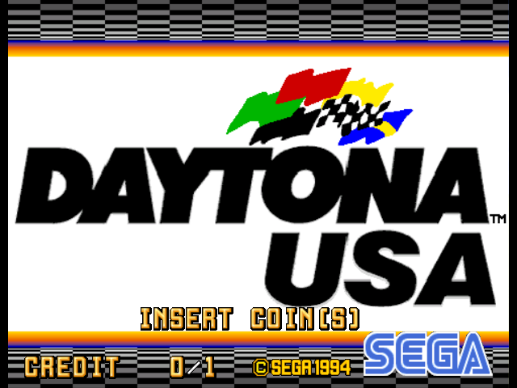
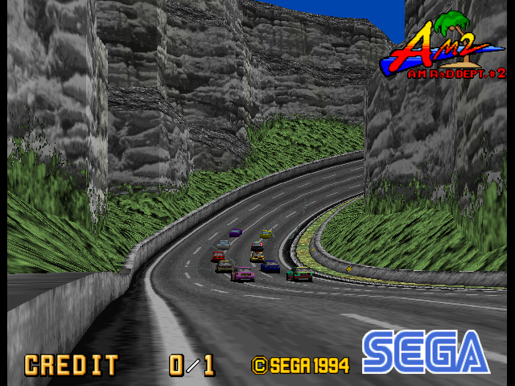

# Original Xbox port

Daytona USA on the original Xbox (733 MHz Pentium III, 64 MB), built with
[RXDK](https://github.com/Team-Resurgent). It is the same recompiled game as
the desktop build: the game code is generated from your own ROM set, so the
result is yours alone and is never shared.

Status: runs on a console at the arcade's full 57.5 Hz, the picture drawn
by the Xbox's GPU every second frame (about 25-29 pictures a second), in
64 MB. Tested in the attract mode; whole races are not yet verified. (xemu
runs it too, much slower than a console.)

  
  

*On an original Xbox, captured from the console's screen over the debug
connection.*

## Build it

You need Python 3.10+, Git, CMake, Visual Studio 2022 with C++ (as for the
desktop build, see the [main README](../../README.md)) and RXDK v1.3.8 or
newer. Then, from the project folder:

    python platform/xboxog/build.py --rom C:\path\to\daytona.zip

`--rom` takes your MAME ROM set as a `.zip`, a `.7z` (named `daytona.7z` or
`daytona93.7z`) or a folder of its files; a clone set and its parent may be
given together. Both `daytona` (Revision A, 1994) and `daytona93`
(Deluxe '93) are accepted; Revision A is the tested one. The first build
fetches the pinned sources and builds the desktop tools (some minutes);
later ones skip what is already done.

Out come, in `platform/xboxog/dist/`:

- `Daytona USA/`: `default.xbe` and `data/`. Copy the folder to the Xbox's
  hard disk (e.g. `E:\Games\Daytona USA`) and launch it.
- `Daytona USA.iso`: the same as a disc image, for xemu.

Revision A's factory settings are a linked twin cabinet, which waits for a
second machine; the build sets a single cabinet in test mode once on the PC
(`single_cabinet.txt`), so the Xbox starts ready to play. Settings and
records are then saved on the Xbox (`T:\`).

## Controls

| Xbox controller | Cabinet |
| --- | --- |
| Left stick, or D-pad left/right | Steering |
| Right / left trigger | Accelerator / brake |
| D-pad up / down, or Black / White | Shift up / down (gears 1-4) |
| A, B, X | View buttons VR1, VR2, VR3 |
| Y or Back | Coin |
| Start | Start |
| Left / right stick click | Test / Service (test mode) |

## HD textures

Every texture the game draws has a name: 16 hex digits from its contents.
With a file `D:\hd\dump.on` (or `T:\dump.on`), each one the game draws is
saved once as `T:\dump\<name>.tga` at its original size. A replacement goes
in `data`'s sibling folder `hd\` as `<name>.dds` (DXT1, DXT3, DXT5 or 32-bit,
power-of-two sizes up to 2048, mipmaps optional): drawn like the original,
greys times the polygon's colour. `<name>_c.dds` is a full-colour
replacement, lit but not tinted.

## How it works

`build.py` drives the steps, each a script of its own:

- `scripts/setup.py` and `scripts/recompile.py` (the desktop's): the ROM
  import, which checks every file, and the game code generated from it.
- `stage_data.py`: the imported images into `game/data` (`D:\data` on the
  Xbox), the ROM regions cut after their last nonzero page.
- `gen_project.py`: the RXDK projects. The title (`src/`, the runtime) and,
  as libraries, the generated game code (at `-Os`, rewritten first by the
  Dreamcast's `fast_gen.py`), SoftFloat and ymfm. Everything is built with
  the Dreamcast port's low-memory runtime and its fast paths
  (`M2_DC_MEMORY`, `M2_DC_SPIN_SKIP`, `M2_DC_SPEED`): the tile layers in
  16-bit formats, composed only when they change, and geometry and layers
  only for the frames that are shown.

The frontend, in `src/`:

- `rom.h`: the 48 MB of ROM regions read from `D:\data` a page at a time
  into a 16 MB cache.
- `renderer.h`: the 16-bit tile layers (the race's scenery as a scrolled
  layer) and the polygons through Direct3D 8, a port of the Dreamcast's
  PVR renderer, with textures cached by content (`hd.h`: the replacements
  and dumps).
- `audio.h`: the native sound sequencer into DirectSound.
- `input.h`: the controller as the cabinet.
- `main.cpp`: the loop, paced to the board's 57.52 Hz, a picture every
  second frame.

Its log goes to the debug output (serial in xemu): memory, frame times, ROM
cache misses, polygons and textures every 10 seconds.
